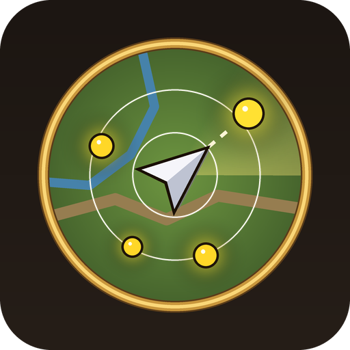

<p align="center"></p>

# Node Scanner

A World of Warcraft: Forever addon that shows the gathering nodes on your minimap
(ore, herbs, treasure chests) in a small window, with a rough distance and an arrow
pointing towards each one.

*Created with the help of AI (Claude).*

```
Gathering Nodes
Copper Vein     ~58  ↗
Silver Vein    ~106  ←
Peacebloom     ~120  ↓
```

## How it works

Since client build 1.60.1.70862 the minimap only reports the dot under the **real**
mouse cursor. Node Scanner therefore does what Minimap Alert does: for a moment it
moves the (invisible) minimap under your cursor, reads which dot is there, and puts
the minimap back. Each scan:

1. checks the nodes it already knows (one read each),
2. sweeps the rest of the minimap for new nodes, continuing where the last scan stopped.

A scan never takes longer than the configured maximum (2 s by default), and it
pauses when you are in combat, turning the camera, holding a mouse button, tabbed
out, using the interface, or standing next to a node so you can click it.

## Features

- Name, rough distance (`~`) and arrow for every node on the minimap, nearest first
- Name coloured by the rarity of the item the node gives (white, green, blue, ...)
- Hover a row: tooltip (what it is, what it gives, distance, direction) and a blue dot
  on the minimap where it is
- **Stand-in map:** while a scan has the real minimap away, a round map with the same
  border shows in its place - the real minimap terrain on Eastern Kingdoms and Kalimdor
  (world map art elsewhere), your arrow, node dots (treasure green, mobs red) and a
  "Scanning for nodes" label. The minimap's buttons, sun/moon and coordinates are copied
  onto it, so the swap is hard to notice
- **Always use the stand-in map (option):** the real minimap is hidden for good and the
  stand-in map is shown all the time - no swapping. Tooltips, clicks, zoom and the minimap
  buttons still work. Town icons (mailbox, auctioneer ...) can't be shown, because the game
  doesn't tell addons where they are. In caves and outside Eastern Kingdoms/Kalimdor the
  real minimap is used. Hovering one of our dots shows the node's name in the normal
  game tooltip
- **All tracking types:** herbs, ore, treasure, beasts, humanoids, undead, demons,
  elementals, giants, dragonkin, hidden. Types your character doesn't have are greyed out.
  Node Scanner switches tracking between the ticked types (one per scan, or several
  together in one scan). Find Treasure stacks, so it is simply kept on.
- **Mobs/NPCs:** one line per name, pointing at the nearest, with the count: `Defias Pillager (5)`
- Pauses in combat, instances, indoors, near a node, with the mouse at the minimap or
  over the interface, while a tooltip is shown or a game window is open (talents, flight
  map ...), optionally in rested areas - each can be switched in the settings
- Several sweep hits on the same minimap dot count as one node
- Warning when Find Minerals / Find Herbs / Find Treasure is off - click to turn it on
- Minimap button, settings window and debug log
- Hovering a dot on the minimap adds it straight away

## Installation

Copy the `NodeScanner` folder into

```
World of Warcraft\_forever_\Interface\AddOns\
```

and restart the game.

## Usage

| Minimap button | Does |
|---|---|
| Left-click | Settings |
| Ctrl-click | Scan now |
| Shift-click | Show / hide the window |
| Right-click | Lock / unlock the window |
| Ctrl-right-click | Debug log |

Commands: `/nscan`, `/nscan options`, `/nscan debug`, `/nscan scan`,
`/nscan status`, `/nscan reset` (puts the minimap back if anything goes wrong),
`/nscan add <name> [herb|ore|treasure]`.

## Versioning

`WoWpatch.Release.Major.Minor`, e.g. `1.2.0.0`. Work in progress is on the `dev` branch;
`main` only gets released versions.

## Rebuilding the minimap tile table

`tools/gen_tiles.py` builds `NodeScanner/MinimapTiles.lua` from the continents' WDT files
(export `world/maps/azeroth/azeroth.wdt` and `world/maps/kalimdor/kalimdor.wdt` from your
own client with wow.export). Only FileDataIDs are stored, no game art is shipped.

## Requirements

World of Warcraft: Forever, interface 16001.

## Credits

The minimap scanning technique is based on Minimap Alert (Loelalol) and its
Forever port, and on the research in NodeRadar's `FOREVER-PROBE.md`.

## License

MIT - see [LICENSE](LICENSE). Free to use, change and share.
